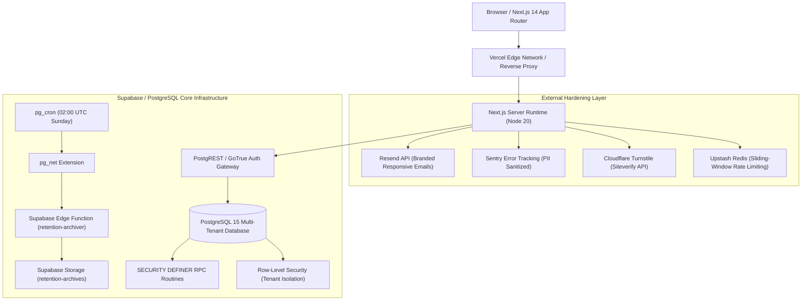
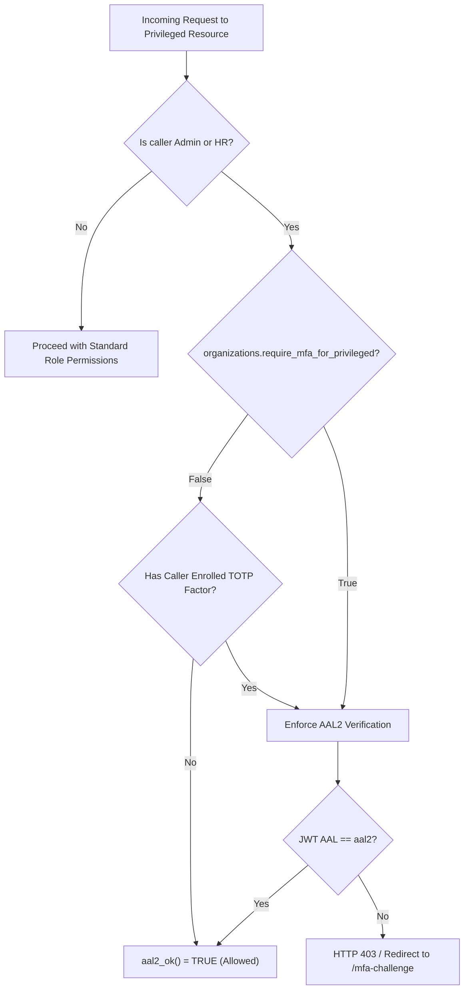

# RemoteHR System Architecture & Technical Design

This document details the architecture, cryptographic security controls, tenant isolation boundaries, and infrastructure integration of RemoteHR.

---

## 1. High-Level Architectural Overview

---

## 2. Multi-Tenant Cryptographic Isolation Model

RemoteHR utilizes an authoritative single-database, shared-schema multi-tenant model enforced through PostgreSQL Row-Level Security:

1. **Organization Scoping**:
   - Every domain entity table (`attendance_sessions`, `leave_requests`, `tasks`, `kpi_scores`, `audit_logs`, `job_titles`, etc.) has an immutable `organization_id UUID NOT NULL` column foreign-keyed to `public.organizations(id)`.

2. **Session Context Resolution**:
   - `auth.jwt() ->> 'organization_id'` and helper functions `current_org_id()` authoritatively bind the caller's query to their tenant context.
   - Cross-tenant queries are blocked at the database engine level; even an explicit `WHERE organization_id = '<other_org>'` returns an empty result set or raises 42501.

3. **Restricted Direct Writes**:
   - Non-admin clients possess zero direct `INSERT` or `UPDATE` grants on core attendance and audit tables.
   - All punch records, leave approvals, and score calculations are mediated by `SECURITY DEFINER` functions with fixed `search_path = ''`.

---

## 3. Privilege & Multi-Factor Authentication Architecture

### Security Helper Functions:
- `mfa_required_for_caller()`: Returns true if caller has an active TOTP factor enrolled OR (caller role is admin/hr AND organization setting `require_mfa_for_privileged = TRUE`).
- `aal2_ok()`: Evaluates `NOT mfa_required_for_caller() OR auth.jwt() ->> 'aal' = 'aal2'`.
- All administrative RPCs (`admin_invite_user`, `admin_create_job_title`, `admin_set_mfa_policy`, `admin_run_retention`) enforce `IF NOT public.aal2_ok() THEN RAISE EXCEPTION ...`.

---

## 4. Rate Limiting & Bot Protection Topology

1. **Distributed Sliding Window**:
   - Sensitive routes use `@upstash/ratelimit` connected to Upstash Redis.
   - When Upstash credentials are not configured, an in-memory sliding-window cache maintains strict rate boundaries without external network dependencies.
   - Limits:
     - `/api/auth/login`: 5 requests / 15 minutes per IP and per email.
     - `/api/auth/forgot-password`: 3 requests / 1 hour per email.
     - `/api/auth/verify-otp`: 5 requests / 15 minutes per email.
     - `/api/admin/*`: 60 requests / minute per user ID.
     - Punch RPCs: 10 requests / minute per user ID.

2. **Cloudflare Turnstile (Single Verification Path)**:
   - Front-end renders the Turnstile widget (<TurnstileCaptcha />) using `NEXT_PUBLIC_TURNSTILE_SITE_KEY`.
   - The application forwards the generated challenge token (`captchaToken`) directly to Supabase Auth (`signInWithPassword`, `signInWithOtp`, `verifyOtp`).
   - Supabase GoTrue performs the single authoritative verification against Cloudflare using the Turnstile Secret Key configured in the Supabase Dashboard (**Authentication** -> **Bot Detection** -> **Turnstile**).
   - There is zero duplicate server-side verification in the Next.js application layer.
   - Exact Supabase Dashboard Configuration:
     1. Open Supabase Dashboard -> **Authentication** -> **Bot Detection (CAPTCHA)**.
     2. Toggle **Enable CAPTCHA protection**.
     3. Select Provider: **Turnstile**.
     4. Enter your Cloudflare Turnstile Secret Key (`0x4AAAAAA...` or test key `1x0000000000000000000000000000000AA`).
     5. Save settings.
