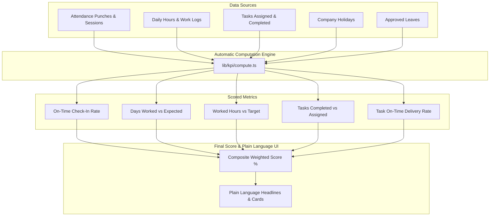
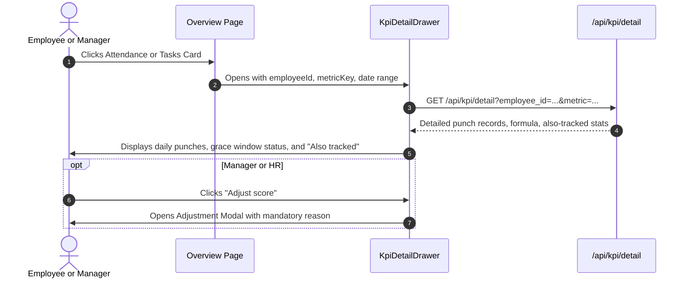
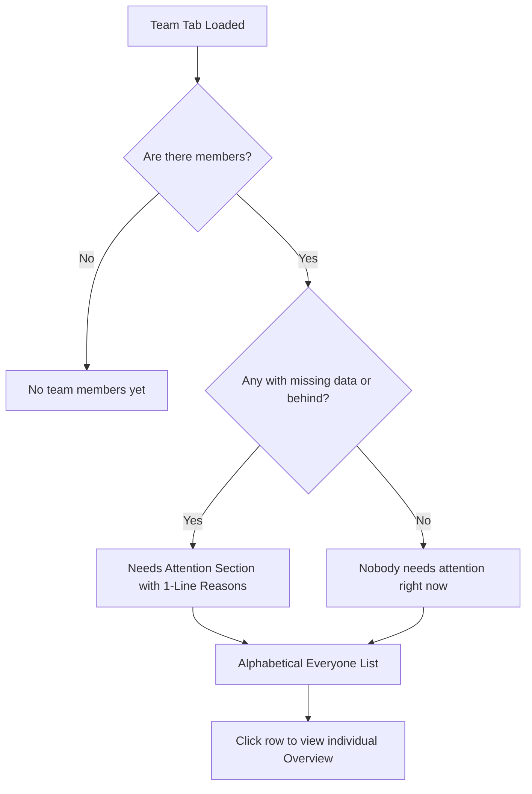
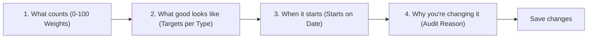

# KPI & Performance Management System: Master Guide & Feature Walkthrough

> [!NOTE]
> This guide is the authoritative reference for the **Pulse by Zen Xea** Performance & KPI module (`/kpi` and `/admin/settings/kpi`). It documents every visual indicator, automated scoring algorithm, operational workflow, and administrative governance control.

---

## 1. System Architecture & Core Philosophy

The KPI module is built around the **10-Second Principle**: an everyday employee, team manager, or HR administrator can open the module and understand their result and next actionable priority in under 10 seconds.

### Key Architectural Pillars
1. **Zero Guesswork / Plain Language**: No ambiguous jargon like "index", "benchmark", or "policy coefficients". Users see human sentences: *"You're on track this month."* or *"Hours logged is slightly behind."*
2. **Objective Automation First**: Shift check-ins, logged hours, and task completions are calculated automatically from database records. Subjective supervisor reviews are captured separately in dedicated sections.
3. **Equitable Credit Rules**: Approved leaves and statutory company holidays **never penalize** attendance or hours scores. Scheduled workdays adjust dynamically.
4. **Task Exemption Handling**: If no tasks were assigned to an employee during an evaluation window, tasks are cleanly exempted from the denominator rather than penalizing the worker with 0%.
5. **Multi-Tier Scoping & Security**:
   - **Employees**: See only their own scores, trend cards, next actions, and reviews. Never see performance band labels or other workers' scores.
   - **Managers**: See themselves and direct reports/department members with "Needs attention" prioritization, drilldown drawers, and guided review forms.
   - **HR & Administrators**: Full organization visibility, versioned benchmark weights, and threshold configuration under `/admin/settings/kpi`.

---

## 2. Period Navigation & Toolbar Controls

Located at the top of `/kpi`, the unified toolbar manages time horizons and persona contexts.

| Control | Position | Available Roles | Behavior |
| :--- | :--- | :--- | :--- |
| **Tab Switcher** | Left | All (Team tab: Managers/HR) | Toggles between **Overview**, **Reviews and goals**, and **Team**. |
| **Period Navigator** | Center/Right | All | `< Prev` and `Next >` buttons to step through periods. Middle button displays formatted date span (e.g., `November 2026 (1 Nov – 20 Nov)`). |
| **Month / Quarter** | Center/Right | All | 1-click toggle between standard Monthly and Quarterly evaluation cycles. |
| **More (Popover)** | Right | All | Popover menu providing access to **Week** view and **Custom date range** pickers. |
| **Person Selector** | Right | Managers, HR, Admin only | Dropdown allowing managers/HR to evaluate any report. **Hidden on self-view and on Team tab**. |
| **Filters Popover** | Right | Managers, HR, Admin only | **Appears strictly on the Team tab** to filter by Department and Employment Type. |

---

## 3. Employee View: Step-by-Step Walkthrough

When employees log into `/kpi`, they view their personal performance summary.

### Screen 1: Headline Hero Card
- **Plain Language Sentence**: Generated by real-time assessment of overall status and weakest metric:
  - *All fine*: `"You're on track this month."`
  - *Overall fine, one weak area*: `"You're on track overall. Hours is slightly behind."`
  - *Overall behind*: `"Behind this month. Check-in days is behind."`
  - *No data recorded*: `"Not enough data yet. Keep checking in and your result will appear."`
- **Status Dot & Label**: Always pairs a high-contrast dot with text:
  - **On track** (`#B7FF00` Lime dot with bold dark text)
  - **Slightly behind** (Amber dot with bold dark text)
  - **Behind** (`#FF007A` Magenta dot with bold magenta text)
  - **No data yet** (Neutral grey dot)
- **Period Trend**: Displays relative points change vs previous cycle (e.g., `+4 points since October` or `Same as October`).
- **Radial Score Ring**: High-precision SVG ring displaying the score once, large in the center, with `Target 90%` neatly presented below the ring.

### Screen 2: Consolidated Attendance & Tasks Cards
- **Attendance Card**: Consolidates punctuality, days present, and hours logged into 3 distinct lines:
  - `On-time check-ins 100%` (with individual status dot and text)
  - `Days present 13 of 15 (87%)` (with individual status dot and text)
  - `Hours logged 104.0h of 120.0h (87%)` (with individual status dot and text)
  - **Card Status**: The status dot on the Attendance card reflects the **weakest** of the 3 lines.
  - **Short Reason Sentence**: Built from underlying punches: *"Present 13 of 15 working days, on time every day."*
- **Tasks Card**:
  - *When tasks exist*: Displays tasks completed vs assigned and on-time completion percentage.
  - *When no tasks assigned*: Shows one compact row: `"No tasks assigned this period, so they're not counted."` with no confusing dashes or negative penalties.

### Screen 3: "What to do next" Card
Surfaces up to 3 immediate, high-priority actions based on live data:
1. **Missing Check-In Days**: Lists exact calendar dates with a direct link to submit regularizations:
   - Example: *"Missing check-in on 12 Nov and 14 Nov"* → `[Request correction]` (opens `/requests` for the earliest missing date).
2. **Pending Self-Review**: Prompts employee when supervisor review cycle is open:
   - *"Self-review reflection is open for this cycle."* → `[Write reflection]`.
3. **At-Risk Goals**: Highlights goals requiring intervention:
   - *"Goal 'Complete Security Audit' is marked at risk."* → `[View goals]`.
4. **Overdue Tasks**: Warns of past-due deliverables:
   - *"2 tasks are past due date."* → `[Open tasks]`.
5. *When all items are clear*: Shows a calm empty state: `"Nothing needed right now."`

### Screen 4: "How this is calculated" Footer
- Collapsible section at the bottom, **closed by default**.
- When opened, details active metric weights, expected scheduled days formula, and effective policy date.

---

## 4. Metric Drilldown & Adjustment Drawer

Clicking any card on the Overview tab opens the **Detail Drawer**.

### What Appears Inside the Detail Drawer:
1. **Mathematical Formula**: Step-by-step arithmetic (e.g., `(13 on-time / 15 attended) × 100 = 87%`).
2. **Plain-Language Explanation**: Explains grace windows, calendar exclusions, and targets.
3. **Day-by-Day Breakdown**: Table of dates with check-in timestamps, status badges (`On Time`, `Late`, `Worked`, `Leave`, `Holiday`, `Missing`), and details.
4. **"Also Tracked" Section**: Metrics tracked for health checks that do not penalize overall score:
   - **Forgot to check out** (auto-closed sessions)
   - **Early check-outs**
   - **Correction requests** (punch regularizations)
   - **Average task cycle time**
5. **Score Adjustments (Manager/HR Only)**:
   - Located exclusively inside the drawer.
   - Managers/HR can input an override value and must provide a mandatory justification note (minimum 5 characters) for audit trail compliance.

---

## 5. Reviews & Goals Tab: Unified Workflow

The **Reviews and goals** tab merges reflections, manager feedback, and strategic objectives into two structured sections.

### Section 1: Periodic Evaluations
- **Self-Review Reflection**:
  - Employees write personal reflections on accomplishments and challenges.
  - Reflections remain editable until the supervisor submits their evaluation.
- **Supervisor Evaluation Form (Guided 4-Competency Review)**:
  - **1 to 5 Rating Scales** with descriptive one-line definitions:
    1. *Quality of work*: Accuracy, thoroughness, and technical standard.
    2. *Communication*: Responsiveness, team updates, and clarity.
    3. *Initiative & problem solving*: Proactivity and resolving blockers.
    4. *Teamwork & dependability*: Collaboration, consistency, and reliability.
  - **Feedback Notes**: Required text field with character counter.
  - **Side-by-Side Reflection**: The employee's self-review is displayed beside the manager form for immediate comparison.

### Section 2: Performance Goals & Milestones
- **Status Pills**: Displays counts for `Not started`, `On track`, `At risk`, and `Completed`. **Automatically hidden until at least one goal exists**.
- **Adding a Goal**:
  - Modal with Goal Title, Target criteria & notes, Evaluation period dates, and Assignee selector.
- **Updating Goal Progress**:
  - Quick status dropdown per goal card (`Not started`, `On track`, `At risk`, `Completed`) with real-time audit logging.

---

## 6. Manager & HR Team View: Team Tab

The **Team** tab provides workforce-level oversight for managers (scoped to their reports) and HR/Admin (organization-wide).

### 1. "Needs Attention" Section (Prioritized Top View)
- Surfaces workers who have missing check-ins, unassigned deliverables, or metrics falling behind.
- Each person has **ONE plain reason sentence**:
  - *"Missed 3 check-ins"*
  - *"No tasks assigned"*
  - *"Hours at 78%"*
- **Empty State Logic**:
  - If organization/team has 0 members: Section is completely hidden.
  - If members exist but none are behind: Displays `"Nobody needs attention right now."`

### 2. Collapsible "Everyone" Directory
- Alphabetical list sorted by employee name.
- Displays Name, Department, Dot + Status word, and Score percentage.
- Clicking any row navigates directly to that employee's Overview with a top banner: `"Viewing <Employee Name>"` and a `"Back to team"` link.
- **No toxic ranks, bottom-performer styling, or comparative distribution bars.**

### 3. Filters & Search
- Live search bar by employee name or department.
- Filters popover (Department & Employment Type) accessible strictly on the Team tab.
- Filter empty state: `"No team members match these filters"` with a prominent `[Clear filters]` button.
- **Export Team CSV**: One-click download of the complete team matrix (auto-disabled when no rows match).

---

## 7. Admin Settings & Benchmarks (`/admin/settings/kpi`)

Accessible only to HR and Administrators to govern weighting, targets, and version history.

### 1. "What Counts" (Metric Weights)
- Five number inputs (0 to 100):
  1. *Punctuality (on-time check-ins)*
  2. *Days present (scheduled workdays)*
  3. *Hours logged (vs shift target)*
  4. *Tasks completed*
  5. *Tasks delivered on time*
- **Three One-Click Presets**:
  - **Balanced**: 20% / 20% / 25% / 20% / 15%
  - **Attendance first**: 25% / 25% / 30% / 10% / 10%
  - **Delivery first**: 10% / 10% / 20% / 35% / 25%
  - *Active Preset Highlight*: The preset button matching current inputs is highlighted with dark styling.
- **Dynamic 100% Sum Validator**:
  - Equal to 100%: Green badge `Weights add up to 100%.`
  - Over 100%: Red warning `Weights add up to 112%. Reduce by 12.`
  - Under 100%: Red warning `Weights add up to 90%. Add 10.`
- **Result Preview**:
  - Computes before and after using the **same sample inputs** (`90, 100, 95, 80, 85`) and the **same function**.
  - If unchanged: `"No change from the current settings."`
  - If modified: `"A typical employee would score 91 instead of 88."`

### 2. "What Good Looks Like" (Targets by Employment Type)
- Tabbed interface: **Full-Time (8h)**, **Part-Time (4h)**, **Intern (8h)**, **Contract (8h)**.
- Target percentage inputs for On-time rate, Days worked rate, Hours rate, Task completion, and Task on-time delivery.

### 3. "When It Starts" (Effective Date)
- Labeled input: **Starts on**.
- Defaults to the 1st of the next month to prevent retroactive recalculation of closed periods.

### 4. "Why You're Changing It" (Audit Reason & Save Governance)
- Textarea for audit justification.
- **Interactive Character Counter**:
  - Stays neutral grey until the field is touched.
  - Turns magenta (`#FF007A`) if blurred/left below the mandatory 5-character minimum.
- **Save Changes Button**:
  - Labeled `Save changes`.
  - When disabled, displays one explanatory line underneath explaining why:
    - `"Weights must add up to 100% (currently 110%)."`
    - `"No changes to save."`
    - `"Please enter a reason with at least 5 characters."`
- **Version History**:
  - Chronological list: `"Changed on <Date> by <Name>: <Reason>"`.

---

## 8. Troubleshooting & FAQ

| Problem | Root Cause | Resolution |
| :--- | :--- | :--- |
| **Team list appears empty for Admin** | PostgREST column mismatch or missing foreign key embed | Resolved by querying `departments:department_id(id, name)` and omitting virtual columns. |
| **Preview says 91 instead of 89 with unchanged inputs** | Hardcoded baseline score vs dynamic formula | Resolved: Both before and after scores are computed dynamically with the exact same inputs and math. |
| **Missing check-in warning in "What to do next"** | Elapsed weekday had 0 attendance punches | Click "Request correction" to jump directly into the punch regularization request form for that date. |
| **Tasks card says "Not counted"** | Employee had 0 tasks assigned in this evaluation window | System automatically exempts tasks so the employee is graded fairly on attendance and hours alone. |
