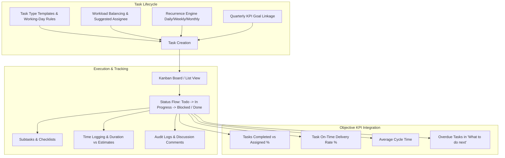
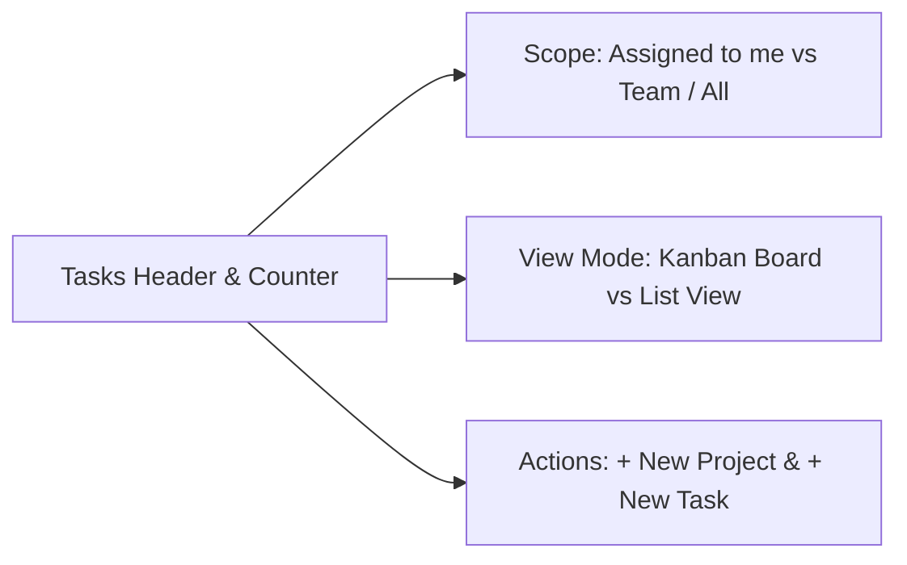
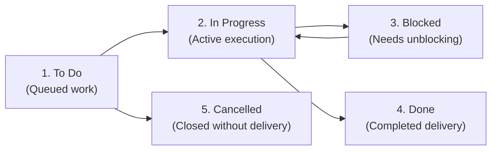
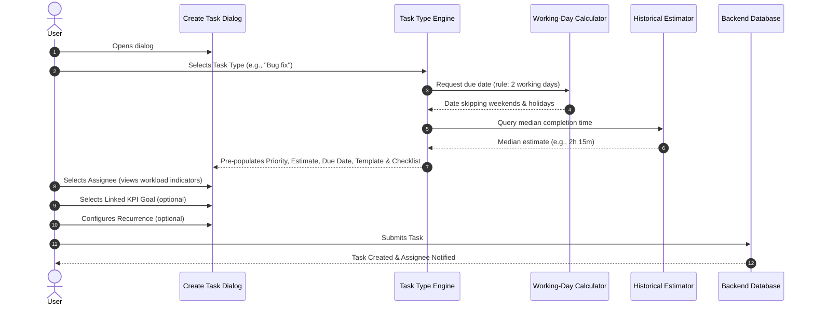
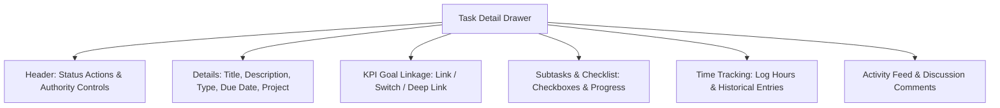
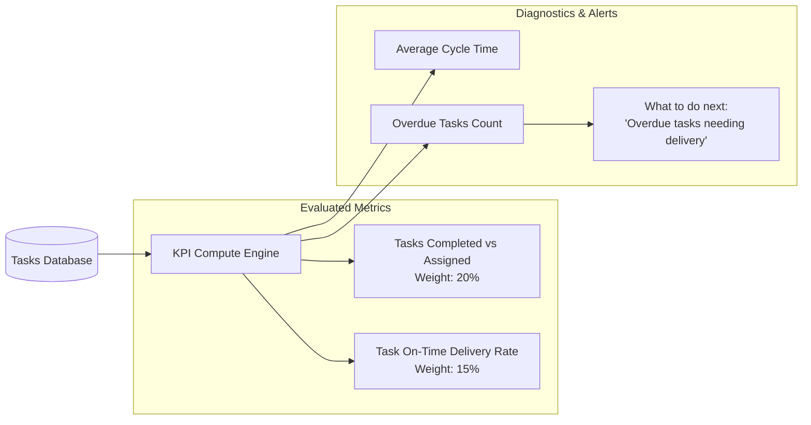

# Tasks & Work Management System: Master Guide & Feature Walkthrough

> [!NOTE]
> This guide is the authoritative reference for the **Pulse by Zen Xea** Task Management module (`/tasks`). It documents the full task execution lifecycle, Kanban board, list view, smart template engine, workload balancing, recurrence engine, subtask checklists, time tracking, audit logs, and direct integration with the Performance & KPI module (`/kpi`).

---

## 1. System Architecture & Core Philosophy

The Tasks module in Pulse is engineered to bridge the gap between **daily tactical work** and **quarterly strategic performance**. Rather than acting as a disconnected to-do list, every task in the system can link directly to an employee's KPI goals and automatically feeds objective delivery metrics into the performance scoring engine.



### Key Architectural Pillars
1. **Zen Xea Design Standard**: High-contrast, clean desktop layout adhering to Zen Xea design tokens: lime (`#B7FF00`) for on-track/completed states, magenta (`#FF007A`) for overdue/cancelled states, amber (`#F59E0B`) for warnings, and crisp monochrome typography.
2. **Template-Driven Efficiency**: Smart Task Types automatically inject standardized descriptions, checklists, default priorities, and working-day due date calculations that factor in weekends and statutory company holidays.
3. **Data-Grounded Workload Balancing**: Task creators can see real-time assignee workloads (`openCount` and `dueThisWeekCount`) and intelligent assignee suggestions based on department affinity and availability.
4. **Self-Assignment Fast Track**: When a user creates and assigns a task to themselves, the system automatically transitions the status from `To Do` to `In Progress` immediately upon creation, eliminating redundant clicks.
5. **Direct Performance Alignment**: Tasks can be explicitly tagged with an active KPI Goal, allowing deliverables to directly substantiate performance self-reviews and manager evaluations.

---

## 2. Page Navigation, Scoping & Toolbar Controls

Located at the top of `/tasks`, the workspace navigation bar provides instant control over viewing mode, organizational scoping, and creation dialogs.



### 1. Header & Task Counter
- **Title**: Displays the page heading `Tasks`.
- **Live Counter Pill**: Shows the dynamic count of tasks matching current active filters (e.g., `14 tasks`).

### 2. Organizational Scoping Toggle
The scope switcher determines which tasks are retrieved and displayed:

| Scope Tab | Target Audience | Behavior |
| :--- | :--- | :--- |
| **Assigned to me** (*My Tasks*) | Default for **Employees** | Displays exclusively tasks where the current user is either the **Assignee** or the **Creator**. |
| **Team / All tasks** | Default for **Managers**, **HR**, **Admin** | Displays tasks across the entire team or organization, filtered by role hierarchy and project access. |

> [!TIP]
> Employees switching between views will only ever see tasks they have permission to access, preserving privacy while fostering personal productivity.

### 3. View Mode Switcher
- **Kanban Board** (`LayoutGrid` icon): Displays tasks distributed across 5 workflow columns for visual pipeline management.
- **List View** (`List` icon): Displays tasks in an information-dense tabular grid with sortable columns, perfect for rapid status updates and bulk review.

### 4. Action Buttons
- **`+ New Project`**: (Visible to Managers, HR, and Admin). Opens the modal dialog to create a new organizational project container with code and department assignment.
- **`+ New Task`**: (Available to all users). Opens the full-featured Task Creation modal with template selector, workload indicators, recurrence controls, and goal linking.

---

## 3. Workload & Status Summary Cards (Bento Metric Strip)

Immediately below the header is a high-visibility summary strip summarizing the active task workload:

| Metric Card | Visual Accent | Definition & Logic |
| :--- | :--- | :--- |
| **Open Tasks** | Neutral Grey Pill | Count of all active tasks currently in `To Do`, `In Progress`, or `Blocked`. |
| **Overdue** | Magenta Pill (`#FF007A`) | Count of active tasks whose due date is strictly earlier than today (`dueDate < today`). Directly flags delivery risks. |
| **Due Soon** | Amber Pill (`#F59E0B`) | Count of active tasks due today or tomorrow. Alerts workers of immediate deadlines. |
| **Completed** | Lime Pill (`#B7FF00`) | Total number of tasks moved to `Done` status within the active scope. |

---

## 4. Search & Comprehensive Multi-Filter Bar

The filter bar provides instant, compound filtering with 1-click reset capability:

```
[ Search tasks... (Ctrl+K) ] [ Status v ] [ Priority v ] [ Due Date v ] [ Type v ] [ Project v ] [ Assignee v ] [ Recurrence v ] [ Clear all ]
```

### Filter Breakdown

1. **Search Input**: Real-time debounce full-text search across task **Titles** and **Descriptions**. Includes a clear `X` button when text is present.
2. **Status Dropdown**: Filter by `All Statuses`, `To Do`, `In Progress`, `Blocked`, `Done`, or `Cancelled`.
3. **Priority Dropdown**: Filter by `All Priorities`, `Urgent`, `High`, `Medium`, or `Low`.
4. **Due Date Dropdown**:
   - `All Due Dates`
   - `Overdue` (past deadline)
   - `Due Soon` (due today or tomorrow)
   - `Upcoming` (due in > 2 days)
   - `No Due Date`
5. **Task Type Dropdown**: Filter by specific template types (e.g., `Bug fix`, `New feature`, `Code review`, `Deployment`, `Documentation`, etc.).
6. **Project Dropdown**: Filter by specific project (e.g., `TECH · Core App`) or `No Project` (ad-hoc tasks).
7. **Assignee Dropdown**: Filter by any visible team member or `Unassigned`.
8. **Recurrence Dropdown**: Filter between `All Tasks`, `Recurring only`, or `One-time only`.
9. **`Clear all filters`**: Appears automatically whenever any filter or search query is active. Clicking it restores the default view instantly.

---

## 5. Kanban Board: Columns, Drag & Anatomy

The Kanban board presents the workflow divided into five distinct stages:



### The 5 Kanban Columns
1. **To Do**: Queued backlog items that have been created and assigned but not yet started.
2. **In Progress**: Tasks actively being worked on. When a user self-assigns a task, it bypasses To Do and lands directly here.
3. **Blocked**: Tasks stopped due to dependencies, missing assets, or external roadblocks. Moving a task here requires entering a **Blocking Reason**.
4. **Done**: Successfully delivered work. Moving a task here triggers the **Log Time Prompt** to record the final working duration.
5. **Cancelled**: Work abandoned or made obsolete. Requires an audit cancellation reason.

### Task Card Anatomy

Each card on the board encapsulates critical information without visual clutter:

```
+--------------------------------------------------------------+
| [HIGH] [Bug fix]                                      (icon) |
| Fix race condition in authentication token refresh           |
| [Target: Complete Q4 Security Hardening]                     |
|                                                              |
| [===-------] 2/5 subtasks                                    |
| (clock) Overdue (18 Nov)   |   (timer) 1h 30m / 3h           |
|                                                              |
| [AR] Aadhithya R.                         [ Start execution ]|
+--------------------------------------------------------------+
```

- **Priority Badge**: High-contrast indicator (`Urgent` in bright magenta, `High` in deep amber, `Medium` in neutral dark, `Low` in subtle grey).
- **Type Badge**: Small rectangular pill indicating the category (e.g., `Bug fix`, `Code review`).
- **Recurring Indicator**: A subtle repeat icon indicating that this task is driven by an automated schedule.
- **Linked Goal Chip**: Displays the linked KPI goal title prefixed with a bullseye target icon.
- **Subtask Progress Bar**: Clean percentage bar showing completed checklist items (e.g., `2/5`).
- **Due State Badge**:
  - **Overdue**: Magenta pill with clock icon and exact date (e.g., `Overdue (18 Nov)`).
  - **Due Today / Tomorrow**: Amber pill (e.g., `Due today`, `Due tomorrow`).
  - **Upcoming**: Neutral pill (e.g., `Due 24 Nov`).
- **Time Spent vs Estimate**: Displays actual logged duration vs allocated estimate (e.g., `1h 30m / 3h`).
- **Assignee Avatar**: Circular avatar with user initials and hover tooltip.
- **1-Click Quick Transition Button**: Contextual button allowing immediate status progression right from the card face without opening the drawer (e.g., `Start execution`, `Send to Review`, `Mark Done`).

---

## 6. List View Walkthrough

When toggled to **List View**, tasks are rendered in a compact, scannable table designed for rapid review and sorting:

| Column | Content & Interaction |
| :--- | :--- |
| **Title & Subtasks** | Primary title, type badge, linked goal indicator, and subtask fraction (e.g., `3/3 subtasks`). Clicking opens the detail drawer. |
| **Project** | Associated project code and name (e.g., `TECH · Core App`) or `—` if unassigned. |
| **Priority** | Visual priority pill (`Urgent`, `High`, `Medium`, `Low`). |
| **Status** | Status pill matching Kanban states. Includes a quick status dropdown menu directly in the row. |
| **Due Date** | Color-coded due date badge reflecting overdue, due soon, or upcoming status. |
| **Assignee** | Team member avatar and name, or `Unassigned`. |
| **Time Logged / Est.** | Formatted duration comparison (e.g., `45m / 1h 30m`). |
| **Actions** | Contextual action button (e.g., `Start`, `Complete`) and three-dots menu. |

---

## 7. Step-by-Step Walkthrough: Creating a Task

Clicking the black **`+ New Task`** button opens the creation modal. The modal features multi-phase intelligent auto-population:



### Step 1: Select a Task Type Template
The template selector organizes types into intuitive groups:
1. **Your Department Types**: Standardized types belonging to your department (e.g., Engineering, Design, Operations).
2. **General Types**: Universal organization-wide tasks (e.g., `Documentation`, `Administrative`).
3. **Other Department Types**: Available for cross-functional initiatives.
4. **Custom / Blank**: Start with a completely blank form.

### Step 2: Intelligent Pre-Population
When a Task Type is chosen, the system automatically fills unedited fields without overwriting what you've already typed:
- **Default Priority**: Automatically selects the template's standard severity (e.g., `High` for bug fixes, `Urgent` for deployments).
- **Working-Day Due Date**: Calculates the exact due date by counting forward only valid working days, automatically jumping over Saturdays, Sundays, and active company holidays.
- **Historical Median Estimate Suggestion**: If 5 or more tasks of this type have been completed with logged time in the past, an intelligent prompt appears: *"Based on previous tasks of this type, average time is 2h 15m. Click to apply."*
- **Description Template**: Injects formatted prompts (e.g., Steps to reproduce, Acceptance criteria, Verification checklist).
- **Checklist / Subtasks**: Injects standard checklist items (e.g., `Reproduce issue`, `Write fix`, `Test edge cases`, `Review changes`).

### Step 3: Assignee Selection & Workload Balancing
When choosing an assignee:
- **Authority Hierarchy Rules**:
  - **Employees**: Can assign to themselves or leave unassigned.
  - **Managers**: Can assign to themselves or any direct report in their department.
  - **HR / Admins**: Can assign to any active employee in the organization.
- **Suggested Assignees**: For department-specific types, the system suggests the top 3 team members with the **fewest open tasks**.
- **Live Workload Indicators**: Beside each employee's name, two badges indicate their current load:
  - `X open`: Total active tasks in progress or queued.
  - `Y due this week`: Urgent deadlines requiring attention.
- **Self-Assignment Fast Track**: If you select yourself, the system automatically marks `isSelfAssign = true`, immediately placing the task in `In Progress` status upon creation!

### Step 4: Link to a KPI Goal
- **Quarterly Alignment**: The dropdown queries all active, non-completed KPI Goals for the selected assignee.
- **Impact**: When linked, completing this task directly moves the needle on the employee's strategic goal and shows up in performance reviews under `/kpi`.

### Step 5: Recurrence Engine (Optional)
Toggle the **`Repeat this task`** switch to turn the item into a recurring template:
- **Frequency Options**:
  - `Daily`: Generates every N days.
  - `Weekly`: Choose specific weekdays (e.g., every Monday and Wednesday).
  - `Monthly`: Select a specific day of the month (e.g., the 1st or 15th).
  - `Every N Working Days`: Runs strictly on business days, skipping holidays.
- **End Date**: Optionally set an expiration date when the schedule should terminate.

### Step 6: Create & Notify
Click **`Create task`**. The task is immediately committed, subtasks are generated, the assignee receives an in-app notification, and the board updates in real time.

---

## 8. Step-by-Step Walkthrough: Task Detail Drawer & Execution

Clicking on any task card or list row slides out the **Task Detail Drawer** from the right:



### 1. Status Progression Actions
Located at the top of the drawer, context-sensitive action buttons let you drive the workflow:
- **`Start Execution`**: Transitions task from `To Do` to `In Progress` and records `started_at`.
- **`Mark as Blocked`**: Prompts for a mandatory **Blocking Reason** (e.g., *"Waiting for API credentials from client"*), moving the task to `Blocked`.
- **`Mark Done`**: Completes the task.
  - If subtasks remain unfinished, displays a confirmation reminder.
  - Opens the **Log Time Prompt** asking: *"How much time did you spend on this task?"* with a pre-filled estimate.
  - Sets `completed_at` to the current timestamp.
- **`Cancel Task`**: Prompts for a mandatory cancellation note and archives the task.
- **`Reopen Task`**: Allows managers or creators to return a completed or cancelled task to `In Progress`.

### 2. KPI Goal Association in Drawer
- Displays the currently linked KPI Goal with its status badge (`On track`, `At risk`, `Not started`).
- A link icon allows 1-click navigation directly to `/kpi` to review the goal's overall progress.
- Users can switch or unlink the goal at any time via the goal dropdown.

### 3. Subtask Checklist Management
- Interactive checkboxes allow crossing off subtasks as work progresses.
- Real-time progress bar recalculates automatically.
- Inline input allows adding new subtasks on the fly.
- When all subtasks are checked off, a prompt highlights that the task is ready for final delivery.

### 4. Time Tracking & Logging
Every task includes built-in duration tracking:
- **Log Time Form**:
  - `Date`: Defaults to today's date.
  - `Minutes / Hours`: Quick presets (`15m`, `30m`, `1h`, `2h`, `4h`) or custom input.
  - `Note`: Optional explanation of work performed during this session.
- **Time History Feed**: Lists every logged entry with the team member's name, date, duration, and note.
- **Total Logged Duration**: Automatically compared against the original `estimated_minutes` to calculate estimation accuracy.

### 5. Activity Audit Trail & Discussion Comments
- **Unified Event Feed**: Chronological log recording every lifecycle milestone:
  - Task created by `User` on `Date`.
  - Status changed from `To Do` to `In Progress`.
  - Reassigned from `Person A` to `Person B`.
  - Time logged entries.
- **Discussion Comments**: Team members can post rich comments, questions, and updates. Submitting a comment dispatches real-time alerts to the task creator and assignee.

### 6. Safe Deletion & Undo
- Clicking the trash icon deletes the task from the database.
- Immediately triggers a **6-second toast notification** with an **`Undo`** button, allowing accidental deletions to be restored instantly with zero data loss.

---

## 9. Creating & Managing Projects

Projects provide high-level organizational buckets for grouping tasks by client, product feature, or internal department initiative.

```
+-------------------------------------------------------------+
| Create project                                          [X] |
| Project name *  [ Core Mobile Application                 ] |
| Project code    [ MOB-APP                                 ] |
| Department      [ Technology                              v]|
| Description     [ Native iOS and Android employee app     ] |
|                                   [ Cancel ] [ Create project ] |
+-------------------------------------------------------------+
```

1. **Access**: Available to Managers, HR, and Admin via the `+ New Project` button in the toolbar.
2. **Project Code**: Short uppercase identifier (e.g., `TECH`, `MKTG-01`) displayed as a badge on Kanban cards and list rows.
3. **Department Assignment**: Limits or associates project ownership with a specific organizational department.
4. **Filtering**: Users can filter the entire Kanban board or List view by project to focus on a single initiative.

---

## 10. Deep Integration: How Tasks Power the KPI Module

The Tasks module is directly coupled to the automated KPI engine (`src/features/kpi/compute.ts`). Daily task activity dynamically impacts an employee's performance score:



### 1. Metric: Tasks Completed vs Assigned
- **Formula**:
  $$\text{Task Completion Rate} = \min\left(100, \left(\frac{\text{Tasks Completed in Period}}{\text{Tasks Assigned in Period}}\right) \times 100\right)$$
- **Weight**: 20% by default in the system KPI configuration.
- **Exemption Rule**: If an employee has **0 tasks assigned** during the evaluation period, the tasks category is cleanly exempted. The system re-normalizes the score over Attendance and Hours so the employee is not unfairly penalized.

### 2. Metric: Task On-Time Delivery Rate
- **Formula**:
  $$\text{On-Time Delivery Rate} = \left(\frac{\text{Tasks Completed on or before Due Date}}{\text{Total Tasks Completed with Due Dates}}\right) \times 100$$
- **Weight**: 15% by default in the system KPI configuration.
- **Grace Period**: Tasks completed on the due date are counted as 100% on time.

### 3. Diagnostics & Cycle Time
- The KPI drawer tracks **Average Task Cycle Time** (elapsed time between `started_at` and `completed_at`).
- Provides managers with objective data on task velocity and operational bottlenecks.

### 4. "What to do next" Overdue Alerts
- If an employee has any active tasks where `due_date < today`, the KPI Overview page displays an immediate priority alert:
  > *"You have 2 overdue tasks needing delivery."*
- Includes a direct 1-click link to `/tasks?due=overdue`, guiding the employee straight to the work that requires urgent attention.

---

## 11. Role & Permission Matrix

| Feature / Action | Employee | Manager | HR / Admin |
| :--- | :---: | :---: | :---: |
| **View Scope** | Personal tasks only | Direct reports & team | Entire organization |
| **Create Task** | Yes (Self-assign) | Yes (Assign team) | Yes (Assign anyone) |
| **Create Project** | No | Yes | Yes |
| **Change Status** | Assigned tasks | Team tasks | Any task |
| **Reassign Task** | No | Direct reports | Any employee |
| **Cancel Task** | If creator | If manager/creator | Yes |
| **Stop Recurrence** | If creator | If manager/creator | Yes |
| **Log Time** | On assigned tasks | On assigned tasks | On any task |
| **Delete Task** | If creator | If creator/manager | Yes |
| **Link KPI Goal** | Personal goals | Team goals | Any goal |

---

## 12. Manual Testing & Verification Checklist

Before deploying or demonstrating the Tasks module, execute this 10-step verification sequence:

- [ ] **1. Scoping Check**: Log in as an employee. Verify that only personal tasks appear under `Assigned to me`. Switch to `Team / All tasks` and verify access restrictions hold.
- [ ] **2. Kanban & List Toggle**: Switch between Kanban Board and List view. Confirm all columns, task counts, and badges render identically without page reload.
- [ ] **3. Template Auto-Population**: Click `+ New Task`. Select `Bug fix`. Verify priority defaults to `High`, working-day due date skips the upcoming weekend, and description template loads.
- [ ] **4. Workload Indicator**: Check the assignee dropdown. Verify team members display live `X open` and `Y due this week` badges, and suggested assignees appear for department types.
- [ ] **5. Self-Assignment Fast Track**: Create a task assigned to yourself. Confirm the task immediately lands in `In Progress` rather than `To Do`.
- [ ] **6. Status Flow & Modals**:
  - Move a task to `Blocked`. Verify the blocking reason modal appears and requires text.
  - Move a task to `Done`. Verify the log time modal appears with pre-filled duration.
- [ ] **7. Recurrence Engine**: Create a weekly recurring task. Verify the repeat badge appears on the card and the recurrence details display in the drawer.
- [ ] **8. Subtask Checklist**: In the detail drawer, check off subtasks. Verify the progress bar updates and subtask count fraction increases.
- [ ] **9. Goal Linkage**: Link a task to an active KPI goal. Navigate to `/kpi` and confirm the linked goal displays the associated deliverables.
- [ ] **10. Deletion & Undo**: Delete a task. Verify the 6-second toast appears with an `Undo` action. Click `Undo` and confirm the task is immediately restored to the board.
